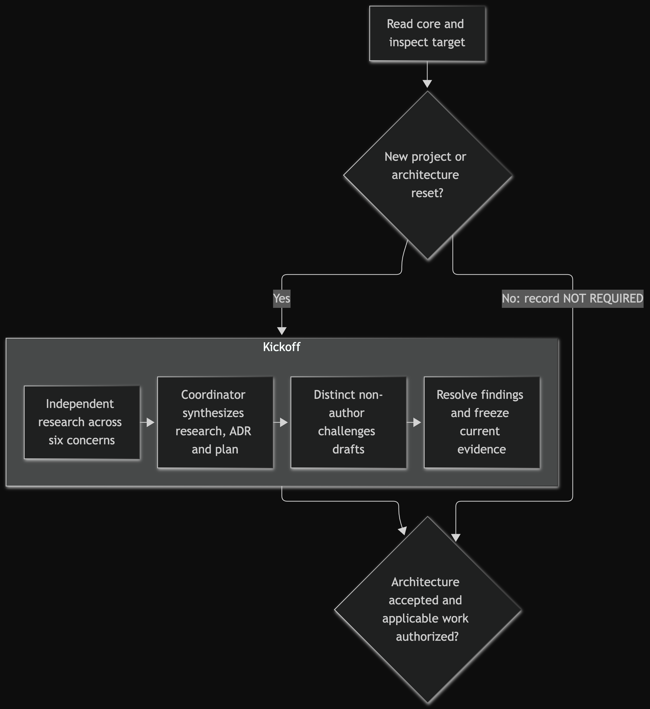
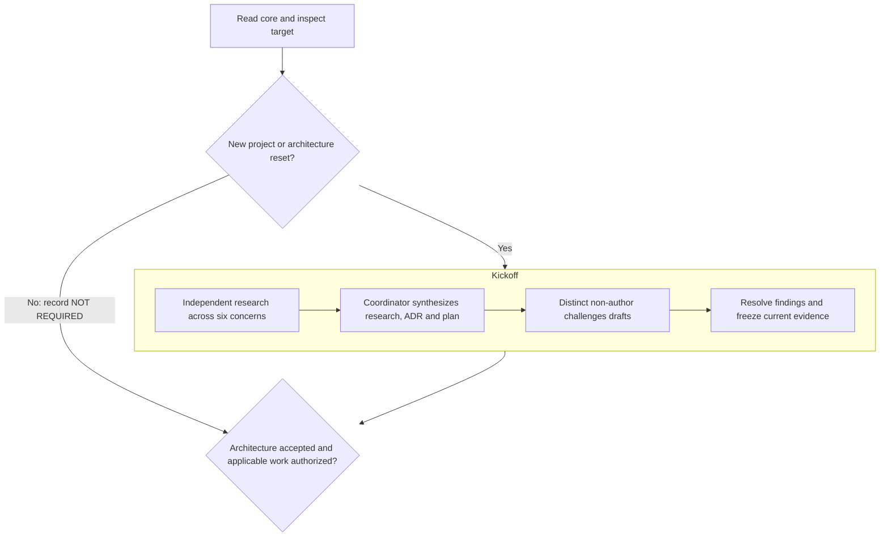
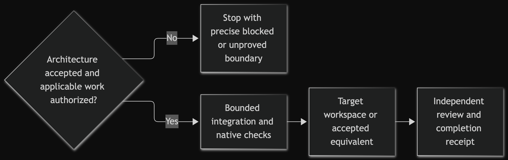
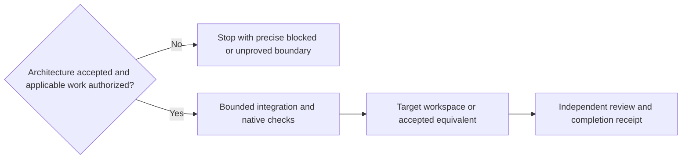

# One-time agent takeover

The engineering agent owns bootstrap. This protocol is a one-time integration task, not a
scripted install and not a permanent project ritual. The CLI can preview, copy, and
compare known files; it cannot understand the target, choose ownership, reconcile
instructions, prove native behavior, or accept risk.

Inputs are the toolkit path, requested outcome, intended target, and the user's
authority boundary. The target may be a new starter/copy project or an existing
project. If ambiguity changes files, privacy, Git, or external effects, stop and ask.

## 1. Take over as orchestrator and read once

Do not implement product code, install target packages, initialize target Git, or publish
while discovering the project. The coordinator owns the integration preflight, is the sole
Git/remote operator, and names one holder for every other mutable or scarce resource. For
a new project or genuine architecture reset it becomes the orchestration-only kickoff
coordinator and launches the lanes in section 2; adoption into a target with an accepted
architecture records the kickoff `NOT REQUIRED` instead.

Read the adoption/navigation core once, in order:

1. the root `AGENTS.md` or `CLAUDE.md` loader;
2. `WARMBOOT.md`;
3. `WHY.md`;
4. this file;
5. `docs/documentation-architecture.md` — role selection, and the only normative
   definition of the four disposition labels;
6. `templates/project.code-workspace`, an inert seed for the mandatory target-owned human
   workspace: adapt or merge it, never install it as truth;
7. `routes/context.md`, then only the evidence, handoff, review, or rotation
   route when its boundary is reached.

Everything else is routed, not missing. Ordinary bootstrap does not load maintainer
history. Examples, templates, capability cards and acceptance machinery stay available,
but a bounded lane reads only the slice its decision needs. This toolkit's build
evidence proves nothing about the target.

Freeze the evaluated Warmboot consumer identity in the adoption record — annotated release
tag, resolved commit, release-manifest path and SHA-256, release state, release-note
digest, target snapshot, dispositions. A missing receipt is `UNPROVED/NON_RELEASE`, which
leaves a later `UPGRADING.md` evaluation `BLOCKED`.

**Capability discovery is a later step, not first-boot reading.** Inspect the target's
native tests, wrappers, hooks, workflows, build/release, data/security, diagram, API,
diagnostic and device surfaces first. Only then open the optional library: its discovery
boundary and twelve-row inventory in `templates/capabilities/README.md` and
`templates/capabilities/MANIFEST.json`, plus the source-lineage boundary in
`docs/capability-sources.json`. After one pass over that inventory, read every
card whose trigger or anti-trigger is material and disposition it as section 4 requires.
Reading a card grants no installation, Git, CI, network, scan, database, deployment, API,
credential, device, LLM, user-data or publication authority.

If the preflight makes the managed helper plausible, inspect `bin/warmboot` and its focused
tests so its absolute-target requirement, preview-unless-`--apply` behavior, create-only
install that never rolls back, merges or overwrites, and fixed-bundle `check` come from
current code rather than this summary. `PREVIEW`, `APPLIED`, and `PASS` are mechanical
evidence, never a decision, ownership transfer, native test result, or compatibility claim.
Then return to the tiny core and task-routed reads.

## 2. Run the mandatory new-project exploration before implementation

This section applies only to a new project or genuine architecture reset. Adoption into an
existing target with an accepted architecture records the kickoff `NOT REQUIRED`, skips
this section including its challenge, and continues with sections 3–4 — still under
explicit scope and authority, native evidence, and proportional independent review.
`NOT REQUIRED` is no blanket implementation or installation grant.

For every new project or genuine architecture reset, cover all six named exploration
concerns below with the smallest proportional multi-agent set: at least two distinct
non-coordinator research owners, an attributed evidence artifact and receipt for every
concern, and exact scope plus a stop condition for every owner. Two is a floor, not a
target — add independent owners when uncertainty, specialist knowledge, or coupled hazards
make another view decision-useful. The coordinator performs no lane research or
implementation:

1. **Objective and context:** clarify the useful outcome, users, constraints, privacy,
   authority, target/repository state, existing instructions, and acceptance.
2. **Current language:** compare suitable languages and runtimes for this objective from
   dated primary/official sources.
3. **Current application stack and portfolio reuse** (portfolio: the target owner's
   proven prior stacks and patterns): use dated primary/official sources to compare
   application/packaging shapes. Start from inspected target-owned precedent where
   applicable; compare its constraints, rights, failure modes and maintenance cost
   before adopting it.

4. **Current developer tooling:** compare, from dated primary/official sources, the
   package, environment, build, analysis, test, and developer tools the objective
   actually needs. Inspect target-native tooling and the language community's current
   source/API documentation form first; precedent may improve or merge into the target
   owner, never replace it by assumption.
5. **Architecture, risk, and privacy:** produce options, boundaries, data flows,
   failure modes, security/privacy/licence risks, operations, and revisit/deletion
   triggers.
6. **Testing, bootstrap, package installation, and operability:** define evidence
   tiers, fixtures, supported environments, prerequisites, runtime/tool versions,
   package manager/lockfile, exact installation and bootstrap commands, local
   operation, recovery, and acceptance.

For a coded target, the tooling and delivery receipts must identify the target-owned
source-comprehension rule, its owner, language/community basis, implementation handoff
gate, non-author review gate, generated/vendor/mechanical exceptions, and disposition of
untouched debt. A plan promise without these operating owners is incomplete.

When local Git history is material to one of those decisions, put the complete
bounded-inspection attestation in that owner's initial assignment — exact absolute
repository, frozen refs/objects and allowed ancestry, exact pathspecs, and exact commands
from `routes/context.md` — rather than making it pause for a relay. The exception
grants only that recorded allowlist: no `git diff`, mutation, checkpoint, remote,
Git-network, credential, or publication authority.

Architecture/risk/privacy and testing/bootstrap/operability use different research owners
for destructive or high-risk work. If the coordinator merges them for a lower-risk
objective, the assignment records why the merge preserves sufficient independence and the
challenge brief explicitly cross-checks path/resource aliasing, source preservation, exact
commands, failure injection, and required platform prerequisites where they apply.

**Small solo project.** The core already allows a small footprint:

- the task template is optional; an existing issue or plan that records the outcome
  and authority can own the work ([core](WARMBOOT.md#start));
- a compatible editor setup can replace the workspace seed once the user accepts it
  and the task records its path, tool, reason and command parity
  ([core](WARMBOOT.md#invariants)).

The kickoff floor stays: two distinct non-coordinator research owners (architecture and
testing concerns share one only with the recorded merge rationale above), one distinct
challenger, and a non-author reviewer for every code change. For a lighter path, use
Warmboot Light, which has no kickoff, upgrade or release tooling.

If current research or a referenced owner overlay is unavailable, use any frozen summary
and mark each affected claim and date `UNPROVED` or `BLOCKED`. Never invent SOTA.

After all six concern receipts and the section 3 preflight arrive, the coordinator only
synthesizes a dated technology-options research brief, the target-specific draft
technology/architecture ADR with revisit triggers, and the concrete draft kickoff/install
plan — all attributed to the six underlying artifacts and their owners. It fills no
evidence gap itself.

Only after all three drafts exist, delegate the challenge to a distinct non-coordinator
owner who authored none of the exploration evidence or drafts and returns its own receipt.
This read-only challenger reviews all three drafts against the underlying concern
evidence, source freshness/primacy, portfolio comparison, architecture and privacy risks,
unknowns, dependency cost, install reproducibility, and the authority gate. The
coordinator disposes every finding in both final artifacts.

Implementation and package installation stay blocked until the challenge is resolved, the
decision owner accepts the ADR, and the plan records explicit `AUTHORIZED` implementation
and install gates. A proposed or `UNPROVED` package is evidence, not a pass.

This is a one-time protocol: afterwards return to proportional topology rather than
repeating full exploration.

## 3. Have the context owner preflight the target

Before Git inspection, the coordinator names one holder for every other mutable or scarce
resource this integration could touch, and attests the same bounded-inspection facts in
the objective/context owner's initial assignment. That owner gathers the dated
repository/worktree identity, branch, HEAD, local history, and staged, unstaged,
untracked, ignored, generated, or concurrent work only through the bounded allowlist in
`routes/context.md`; it uses no `git diff`, inspects no other repository,
receives no credentials, contacts no remote, and gains no mutation authority. The
coordinator remains the sole Git mutator and independently refreshes authoritative
status/diff before any mutation. The owner returns its own evidence artifact and receipt.

First classify the path. For a **new starter/copy**, inspect the parent and proposed path
for collisions and authority, and any starter/source being copied — instructions,
provenance/licence, Git metadata, secrets, caches, generated files, exclusions — then
decide the smallest copy or creation mechanics. Do not create the target until the
proposal is safe and authorized. For an **existing target**, preserve its identity and
inspect it in place.

Read-only inspect and record, where present: all target instructions and their
path/precedence, including provider loaders, plus current task, plan, handoff, decision,
or recovery artifacts; the coordinator's exact Git snapshot — worktree status, HEAD/branch,
remotes if relevant, and staged, unstaged, untracked, ignored, generated, or concurrent
work — `BLOCKED` if it is missing or irreconcilable with the visible target;
project-native test, lint, build, validation, and bootstrap commands from current source,
never guessed from its language; root `*.code-workspace` and `.vscode/` files whose folders,
settings, tasks, or launch behavior a generic workspace must not erase; secrets, personal
data, privacy boundaries, and files that must not be copied, committed, or sent to a
provider; and authorized changes, Git actions, external effects, reviewers, and any
missing access or decision.

Preserve unrelated dirt; never absorb it into the snapshot or use it as evidence. Record
`BLOCKED` where safe integration needs authority or information the agent lacks.

## 4. Decide the integration and documentation roles

Write the smallest exact-path proposal and why each recurring file earns its cost.
Choose one:

- **Use the managed bundle** when the target has no conflicting files and its
  instruction precedence is understood; CLI preview may inform the proposal.
- **Reconcile manually** when useful target loaders/instructions already exist. Preserve
  their semantics and stronger safety constraints; add the smallest clear route to one
  neutral core rather than overwriting or creating competing rulebooks. Exact-content
  `check` then does not apply (no manifest is written).
- **Do not integrate** when the toolkit adds no decision value, conflicts cannot be
  reconciled safely, privacy/authority is missing, or recurring tax exceeds benefit.

Never delete or overwrite an existing loader merely because the CLI prefers other bytes:
reconcile it manually, or first move its content as in
[Existing agent instructions](#existing-agent-instructions). Never add language settings,
extensions, provider adapters, CI, or standing process without a reproduced target need;
an adapter also needs an owner, native proof, recurring cost, and a deletion condition.

Using the role index, record one decision — `ADOPT`, `MERGE INTO EXISTING`, `CITE ONLY`,
or `OMIT` — for each relevant role or source record. `docs/documentation-architecture.md`
is the only normative definition of those labels and of the deviation burden a material
`CITE ONLY`, `OMIT`, or novel replacement carries; this file does not redefine them.
Samples are never automatic payload: adapt every placeholder and native command before
adoption, and never create a second source of truth. The workspace in section 5 is a
required deliverable, never `CITE ONLY` or `OMIT` by preference.

Apply the same discipline to the capability cards opened in section 1. Ordinary
adoption selects relevant cards; exhaustive coverage belongs to the cold
outsider audit. Record each disposition, destination, target constraint,
surviving owner/native command, focused and closing evidence, recurring tax,
revisit trigger and any `UNPROVED` or `BLOCKED` boundary. Related-card links
provide navigation and grant no installation or live-action authority. Use
existing native commands and wrappers.

`examples/MANIFEST.json` records sample licences;
`docs/capability-sources.json` binds local capability rationale and rights. Neither is
a source of target command authority.

The accepted project also owns its language-appropriate maintainability, testing,
documentation, and architecture constraints. Inspect and reconcile existing native
formatting, lint/static-analysis, API-documentation, architecture, complexity and test
owners before proposing additions. The resulting standards must make consequential
intent reviewable by humans as well as resumable by agents: adjacent rationale and
invariants for non-obvious algorithms, units, numerical/coordinate assumptions,
concurrency, caching, idempotency, retries, persistence and privacy; independently
derived test expectations; evidence-tier and skip policy; and discoverable living
documentation with owners and update triggers. Reject comments that restate code,
comment/Javadoc/test/diagram counts, coverage-percentage theatre, and universal tool
mandates. For every human-authored code file, adopt the community-normal form that gives
a reader immediate orientation—module/file documentation, a type contract, or the
language's equivalent. One accurate sentence is enough for a simple file. Generated,
vendored and purely mechanical re-export/forwarding files may use a recorded provenance
or exception instead; never pad them.

Consequential code adds adjacent operative rationale: why the choice exists, its
invariants and precedence, applicable units/bounds, and failure/state/concurrency/
security/resource semantics. Tests and a repository-level ADR do not substitute for
local comprehension. An exact ADR-section anchor may deepen the explanation only after
the source itself states its local role and contract. Agent memory, a transcript or a
handoff is never the owner of this rationale.

A project may keep a locally calibrated SLOC, file-size, complexity, or dependency
pressure as a review/refactoring trigger when it improves cohesion and context size.
Bootstrap records its native basis, exception rationale and reviewer evidence; Warmboot
does not supply a universal cap or treat it as a comment proxy. Use an editable source-
controlled diagram format (for example Mermaid or SVG) only when it materially clarifies
relationships, state or data flow, with a text alternative, owner and update trigger.
Durable prose remains human-readable;
token-saving fragments are not a documentation format.

### Existing agent instructions

This is the managed-bundle route. The installer refuses an existing `AGENTS.md` or
`CLAUDE.md` before writing anything. Move their project-specific content into a
target-owned file, such as `docs/agent-instructions.md`, and link it under **Governing
instructions** in the task artifact the core makes every session read (see
`templates/TASK.md`). Then remove the originals and install. The alternative is to
reconcile manually: keep the existing loaders, copy the core and routes into
`.agent-warmboot/` by hand, add one line to each loader that routes to the core, and
accept that `check` does not apply because no manifest is written.

### Coded-project operating floor

Any target containing human-authored code—including small helper scripts—must leave
these owned roles current. Merge them into existing credible surfaces when that is
clearer; do not manufacture one file per role:

- a human README/start route and conventional navigable source/test/docs layout;
- target-owned source/engineering rules and native testing/evidence commands;
- a proportional component/ownership map, which may be a short README or plan section
  for a tiny project;
- user/maintainer-visible change history and an observed-defect/recurrence owner;
- one current task or plan carrying authority, acceptance and next state; and
- a blocking non-author review gate for every code change and other material work.

Record `NOT APPLICABLE — NO HUMAN-AUTHORED CODE` only when inspection proves the target
has no code. A missing separate file is acceptable when another named current surface
owns the role; a missing role is not.

For a materially complex or multi-component coded project, adopt or merge one current
quality-control loop into the active plan, system map or a dedicated quality assessment.
At useful milestones it assembles evidence by applicable concern—architecture/
ownership, source comprehension, testing, and security/privacy/operations where real—
keeps unknowns explicit, and assigns each material weakness an owner plus next action or
revisit trigger. A human owner or genuinely independent non-author challenges it.
Letter grades and numeric scores are optional views, never self-closing evidence; tools
may collect facts and regression signals but cannot certify semantic adequacy. A tiny
project may merge this loop into ordinary planning and review.

## 5. Leave the required human-and-agent workspace

Bootstrap is incomplete until the target leaves one usable, target-owned root
`*.code-workspace`. The only exception is an already target-owned or explicitly
user-accepted compatible human workspace replacement. Record its path, tool, reason,
and navigation/setup/test/run/debug parity in the target README/task. An agent's editor
preference is not a replacement reason; the user's accepted choice is. A `.sln`, Xcode
workspace, Android Studio/JetBrains project, or other native IDE artifact may coexist;
it does not replace the root VS Code workspace without that explicit acceptance.

After the technology/architecture decision and before bootstrap completion, inspect
all root workspaces and `.vscode/` owners. Reconcile rather than overwrite, and record
the surviving workspace path plus the owner/disposition of each field:

| Field | Required decision |
|---|---|
| `folders` | Include `.` and only real project-relevant folders that exist now; use names that help human navigation. |
| `settings` | Preserve compatible existing settings; add only target-proved editor/language/search/format ergonomics, never secrets, provider policy, or user-global preferences. |
| `tasks` | Mirror current target-owned setup, focused/ordinary/full test, lint/format/build/run commands only when they already exist and are useful. Never invent a wrapper or add install, deploy, data, network, Git, credential, or publication actions merely to populate the file. |
| `launch` | Add only real local run/debug entry paths with correct working directories and non-secret configuration; omit when none exists. |
| `extensions.recommendations` | Recommend only extensions earned by accepted languages, formats, tests, or local operations. Recommendations never install anything. |

The file is mandatory; optional fields are not. A planning-only project may therefore
leave a named root folder plus currently useful documentation/language ergonomics and
defer speculative tasks/launches until their commands exist.

- With no root workspace, create `<target-directory-name>.code-workspace`, adapt the
  inert seed, and record target ownership.
- With one root workspace, merge/improve it in place. Preserve its name, JSONC style,
  unknown compatible keys, useful fields, and stronger target constraints.
- When `.vscode/` already owns a setting, task, launch, or extension list, keep that
  owner instead of duplicating it. The root workspace can include the folder so those
  settings remain active; record the surviving owner.
- With multiple workspaces, determine their distinct purposes before choosing a
  canonical human entry. Preserve intentional variants. Unknown overlap is `BLOCKED`,
  not permission to delete.
- Preserve invalid, special, symlinked, concurrently changing, or unknown-owned
  workspace bytes and stop before mutation unless the user accepts a documented
  replacement.
- On a same-key conflict, current target-native behavior wins unless accepted current
  evidence proves it stale. A generic seed never breaks the tie.

The workspace grants no authority and contains no agent rules. `AGENTS.md`/`CLAUDE.md`,
current source/manifests, accepted ADRs, and test documentation remain truth. Before
marking bootstrap complete, parse/inspect the surviving workspace as appropriate,
verify every folder and mirrored command against its current owner, and record any IDE
execution not run as `UNPROVED`. Helper `APPLIED`/`PASS` does not evaluate or prove
this outcome.

## 6. Execute as owner after the applicable authority boundary

For a new project or genuine architecture reset, execution waits for the kickoff gate.
For adoption recorded `NOT REQUIRED`, it waits instead for the accepted target-specific
integration decision and exact task authority, inheriting no product or
package-installation authority. The coordinator owns the accepted proposal even when
bounded lanes are delegated; give every lane exact paths, allowed operations, proof, and a
stop condition, and serialize overlapping writers. Recheck target state immediately before
mutation. Install only ADR/plan-approved packages through the recorded package manager and
lockfile, and verify the exact bootstrap commands before feature work. Apply only accepted
paths, by hand or with CLI `--apply` after reviewing its exact preview.

Creation is non-overwriting and refuses detected replacement. It assumes no other actor
relocates opened parent directories: writes retain the opened inode, which can move
outside the target before a write. Postflight detection refuses `APPLIED` and preserves
residue; it does not provide continuous pathname containment or rollback. Recorded
residue paths may have moved. If a compatible partial install remains after an
interrupted run, inspect it and rerun. Preserve incompatible or unexpected paths and
resolve ownership rather than deleting them automatically. Helper-created files remain
`0600`, directories `0755`; the default is one OS account, and manifest checks do not
verify modes.

The coordinator chooses checkpoint contents by exact reviewed path, alone stages or commits
them, and alone may perform a separately authorized push, merge, or other Git/remote
operation. Deploy, messaging, and other external effects stay separately authorized.

An owner addendum or material change to outcome, acceptance, hazards, assumptions,
architecture, interfaces, inputs/digests or lane needs revises the existing task before
execution continues. Impact-analyze every lane and evidence dependency; preserve matching
unaffected receipts and renew, rerun or stop affected/uncertain work. A stopped lane
records proved work, the unproved remaining outcome and its explicitly appointed holder.
Its handoff does not transfer ownership. When the selected protocol is orchestration-only,
the coordinator does not absorb that remainder; only an unavoidable recorded integration
hotspot may be coordinator-authored and it receives independent review.

Each implementation lane's definition of done covers every changed human-authored code
file: classify simple versus consequential, add or update its native orientation and
applicable local rationale, correct stale/decorative prose, and inventory any untouched
high-risk documentation debt found nearby. Before handoff the coordinator freezes and
attests the candidate source set from target-native change/status evidence, with
recorded generated, vendored and pure re-export exceptions; the writer reconciles its
path-by-path assessment against that set; the independent non-author reviewer repeats
the reconciliation and reads every resulting file. An omitted file is a `FINDING`, and
green tests alone cannot close it. The procedure is in
`.agent-warmboot/routes/context.md` and `.agent-warmboot/routes/review.md`.

## 7. Prove, review, and hand off

Run the cheapest native checks that reach the integration hazards, plus any inspection
needed for instruction discovery and routing. On the managed CLI path, `check`
may prove manifest-declared structure and content. The manifest and `source_revision` are
self-declared local metadata: a coherent rewrite of both still passes, so `check` proves
neither authenticity, provenance, target behavior, provider parity, ownership, nor privacy
— anchor provenance to an externally recorded commit, tag, or digest. Helper checks prove
only their observed snapshot; `APPLIED` means validation passed then, not permanence.
State unrun or unavailable required proof `UNPROVED` or `BLOCKED`.

Obtain an independent, scoped `CLEAN`, `FINDING`, or `BLOCKED` review of the exact
changes, preservation of existing instructions/dirt, native evidence, and recurring tax.
The reviewer reads every changed human-authored code file, not a sample. Missing,
stale, decorative or remote-only orientation/rationale is a `FINDING` even when tests
pass; verify recorded generated/vendor/mechanical exceptions and the prioritized debt
inventory for untouched code. For a current quality-control loop, challenge evidence,
unknowns and owned next actions rather than accepting a grade.
On `FINDING`, a separate writer fixes accepted findings, affected evidence reruns, and a
non-author rereviews the unchanged corrected candidate. Repeat to the predeclared target-
native `CLEAN` threshold (no actionable finding in scope), or `BLOCKED`. Any
relevant decision/byte/evidence change expires `CLEAN`; fixed review counts do not prove
dryness. At a reviewed green boundary the coordinator may create an authorized exact-path
local recovery commit. Publication stays separate.

Finish in the target's existing task or handoff artifact with:

- decision and exact changed paths;
- sole Git/remote operator, other singleton-resource holders, the snapshot, preserved
  concurrent dirt, and any local checkpoint;
- native and mechanical evidence clearly separated;
- required workspace path (or accepted replacement), field owners, command-parity
  evidence, and any IDE execution left `UNPROVED`;
- review verdict, `UNPROVED`/`BLOCKED` boundaries, and remaining hazards;
- changed-source assessment, local rationale/ADR anchors, recorded exceptions and
  prioritized untouched debt;
- Warmboot release identity/manifest/release-note receipt, target snapshot and final
  dispositions;
- the tiny steady-state entry point and next authorized action.

Reuse the current tracker. Bootstrap ends here; ordinary work loads the core and only the
route its task needs.

## Bootstrap at a glance

<!-- mermaid-render:begin sha256=22b23ddfb518636b0a5c614fed55fc93050e5635ab2988bf7ef193ac50203501 -->

Mermaid source

<!-- mermaid-render:end -->

<!-- mermaid-render:begin sha256=211e3114886986ad3d0ab30a1bc52d7c139c959e6c3bb55b2d77830a256e7d0f -->

Mermaid source

<!-- mermaid-render:end -->

The diagram summarizes the gates above. Skipping kickoff never skips authority,
preservation, workspace, native proof or independent review. Owner: bootstrap
maintainer; update with the corresponding gate whenever the process changes.
