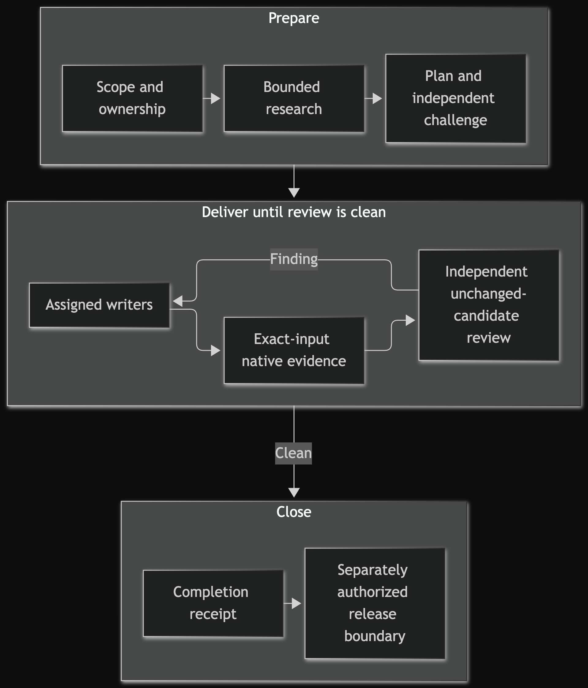
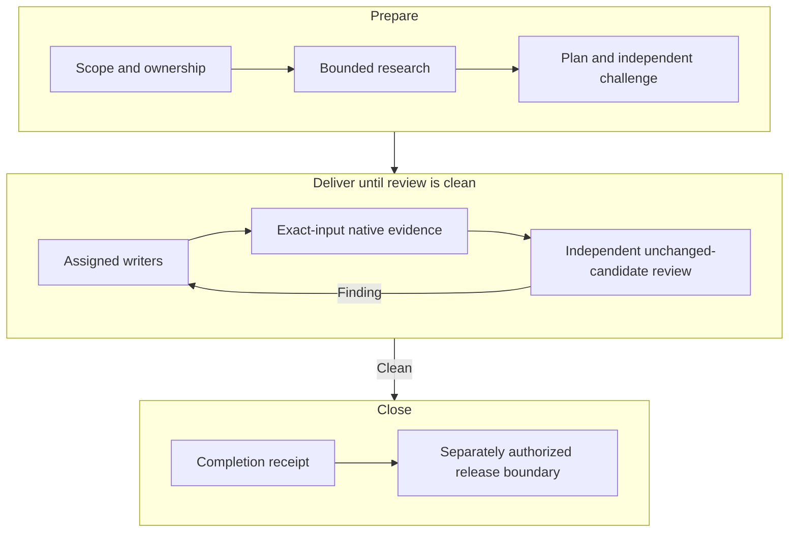

# Maintaining Warmboot Full

This repository improves itself using the same ownership, evidence, review and
freshness rules it gives consumers. It does **not** need a permanent improver
repository or a copied maintainer tree. Isolation comes from temporary clean checkouts
or worktrees at exact revisions; the current repository
remains the only documentation and release authority for Warmboot Full. Consumer projects retain authority over their own behavior.

## Accept ownership

The normal invocation is:

```text
Read AGENTS.md or CLAUDE.md. Take full ownership of improving Warmboot Full at
<ABSOLUTE_REPOSITORY> for <IMPROVEMENT_OBJECTIVE>. Treat <FROZEN_COMMIT_OR_TAG> as the
immutable consumer baseline. Follow MAINTAINING.md, orchestrate only, do not edit
other repositories, and do not publish remotely without my authorization.
```

The top-level coordinator is orchestration-only. Before mutation it:

1. resolves the absolute repository, objective, frozen baseline, current task and
   instruction precedence;
2. reads `WHY.md`, `WARMBOOT.md`, this file, `ROLE-INDEX.md`,
   `docs/maintainer-system-map.md`, `docs/engineering-standards.md`,
   `docs/testing.md`, `docs/invariants.md`, `docs/adoption-disposition.md`, the
   current plan, relevant ADRs/studies, root histories, acceptance authority and
   release record;
3. records scope, non-goals, hazards, exact allowed paths, user authority, acceptance,
   known `UNPROVED` boundaries, current repository snapshot, and concurrent work;
4. names itself as the only Git/remote/release holder and names one holder for every
   other mutable path, temporary checkout, source archive, fixture and report; and
5. freezes the baseline input and candidate input separately. Workers receive only
   coordinator-attested paths and digests. When history changes a decision, their
   initial assignment may include the exact local repository, frozen refs/objects and
   ancestry, pathspecs, and commands from `routes/context.md`; they gain no
   `git diff`, mutation, checkpoint, remote, Git-network, configuration, worktree-
   administration, or credential authority.

`<FROZEN_COMMIT_OR_TAG>` is an ordinary immutable comparison input for maintenance;
it is not automatically a consumer release. A released consumer identity is one
annotated release tag plus its manifest/receipt, although the tag's resolved full
commit may be used as the immutable pin.

Workers edit only coordinator-attested toolkit paths. They do not inspect or mutate
unrelated repositories, copy credentials or user data, or infer remote authority.
The sole active backlog is `docs/plans/warmboot-build-plan.md`. Missing authority is
`BLOCKED`; unavailable runtime or provider proof is `UNPROVED`.

## Choose the smallest honest topology

For ordinary Warmboot maintenance a small, already-understood
correction uses one bounded writer and a distinct reviewer; only a correction that
changes no code and carries no material risk may omit the reviewer. A change to
architecture, instruction discovery/precedence, bootstrap ownership, the
consumer/maintainer boundary, or the immutable release boundary uses the full set of
six named kickoff concerns with the smallest proportional multi-agent topology:

- at least two distinct read-only non-coordinator research owners cover
  objective/context; language/runtime; application stack/portfolio precedent;
  tooling; architecture/risk/privacy; and testing/bootstrap/package/release
  operability with attributed artifacts and receipts;
- two is a floor, not a target; independent owners are added when risk, uncertainty,
  or specialist evidence makes another view decision-useful;
- destructive or high-risk work separates architecture/risk/privacy from
  testing/bootstrap/operability, or records why merging is safe and gives the
  challenger explicit cross-checks for the coupled hazards;
- the coordinator does no lane research or implementation and only reconciles the
  receipt-bearing evidence into the study/ADR/plan;
- a distinct non-author owner challenges those drafts after their exact SHA-256
  values are frozen; and
- implementation waits for reconciled findings and explicit authority.

Ordinary documentation, fixture or defect corrections do not manufacture kickoff
lanes.
Parallel owners never share a write hotspot. Every reviewer returns exactly `CLEAN`,
`FINDING`, or `BLOCKED`; any later changed byte expires `CLEAN` for that scope.

For this repository and every material toolkit-improvement task, orchestration-only is
a persistent boundary, not a kickoff phase. A coordinator does not absorb delegated
research, implementation, experiment, or review after a lane stops or a user addendum
arrives. It reconciles the addendum into the current task, impact-analyzes every lane and
receipt, preserves unaffected digest-bound evidence, and renews, reruns, or stops only
affected assignments. A stopped lane records the remaining outcome and next holder.
Coordinator implementation is limited to an unavoidable shared integration hotspot,
recorded before editing with why no bounded writer can safely own it and independent
review of those bytes. Do not create a fixed permanent team to enforce this boundary.

Maintainers assess portable human-inspectability fallout with every engineering-rule
change. The consumer guidance must help a target select language-appropriate native
formatting, static analysis, architecture, documentation and testing owners; preserve
rationale and invariants that names/types cannot express; keep project documentation
navigable to a human collaborator; and prevent comment, coverage, test, diagram, or
complexity-count theatre. Existing project precedent is a reasonable balance to challenge and
adapt, not a universal tool or threshold mandate. Warmboot's own rule and maintainer
text must meet that same human↔machine operability bar: concise role, local why, and
plain language rather than platform mechanics or filler.

For every code change, the coordinator freezes the candidate snapshot and attests the
candidate source set: every added, renamed or modified human-authored Warmboot code
file, plus recorded generated, vendored and pure re-export exceptions
(`routes/context.md`, "Candidate source-set attestation"). The implementation
owner applies the repository's language-native orientation/rationale rule to every file
in that set and reconciles its path-by-path assessment against the attestation before
handoff; its own list cannot attest completeness. The independent non-author reviewer
repeats that reconciliation and reads every resulting human-authored code file in full
(`routes/review.md`); an omitted file, or missing, stale, decorative or
remote-only explanation, is a blocking `FINDING` despite green tests. The active backlog
owns the proportional quality-control loop and untouched debt priority; neither a score
nor an agent transcript is acceptance evidence.


## Keep baseline and candidate independent

When an immutable-release comparison is selected, the coordinator resolves
`<FROZEN_COMMIT_OR_TAG>` and records its exact commit. Use a
separate temporary clean checkout/worktree for that baseline and a different temporary
checkout/worktree for the candidate or consumer exercise. Never run before and after
against one mutable directory. Record paths, revisions, prompt/objective digests,
commands, outputs, owner identities and limitations in the active evidence record.

Run cheapest valid proof first:

1. scoped syntax, JSON, link, table, whitespace and unit checks;
2. the deterministic local suite and changed-boundary checks in `docs/testing.md`;
3. a brand-new context-clean cold agent on the frozen baseline using the minimal
   objective, and a different brand-new agent on the candidate using the same input;
4. a distinct fresh resumer for the bounded stale-receipt probe; and
5. independent adversarial review of the unchanged candidate and evidence.

Steps 1–2 are deterministic tiers: `docs/acceptance.md` holds the deterministic command
inventory and `docs/release.md` holds the release verifier's command; a pass proves only
named bytes and invariants for exact inputs. Steps 3–4 are live tiers; each proves only
its own run. `docs/testing.md` selects what a change owes; the active evidence record
keeps the exact commands, counts, identities and skips. An unavailable tier is
`UNPROVED`, or `BLOCKED` without authority or input; no lower tier stands in.

Those baseline/candidate, identical-input and resumer steps are ordinary Warmboot
evidence patterns. No historical receipt substitutes for the current selected evidence.

An agent that saw the implementation cannot count as the after consumer. A structural
oracle proves structure only, never agent discovery, provider behavior or runtime
utility. Record skipped proof honestly. Add a regression pin only after an observed
defect, with an owner, causal recurrence signal, behavior-check insufficiency,
recurring tax and deletion condition.

## Recover stale or interrupted work

Do not trust a handoff because its prose looks current. Recompute every named path and
digest, compare the relevant baseline/candidate/review inputs, and mark a mismatch
`STALE` and `RERUN NOW`. Reload the owning task, ADR, plan, evidence and changed paths;
then issue a fresh routine receipt. It inherits no policy, scope, implementation,
ownership, commit, publication, topology, review sequence, or provider process.

A pause, resume, session/provider change, or disjoint cross-provider lane under the
same coordinator is not rotation. Use the quiescent `RELINQUISHED`/independent-
preflight/`ACCEPTED` protocol in `routes/rotation.md` only when an explicitly
named replacement takes over from the actual active coordinator, Git holder, or
another scarce-singleton holder.

## Change, review, checkpoint and publish

Keep one authority per role. Update documentation, examples, tests, `CHANGELOG.md`,
`BUGFIXES.md`, ADR status, source lineage, acceptance limits and release fallout in
the same change that makes them inaccurate; do not leave a parallel correction note.
Use `ADOPT`, `MERGE INTO EXISTING`, `CITE ONLY` or `OMIT` for source precedent and make
novelty bear the evidence burden described in `docs/source-refresh.md`.

Only the coordinator selects exact reviewed paths for a local recovery commit. A
local commit is not publication and is not a release. Remote creation, push, tag,
release, merge, deployment or other external effect requires the user's explicit
authority for that exact repository and boundary. At an authorized release, follow
`docs/release.md`: finalize authored bytes, have the holder write revision/notes and the
manifest last, then create an exact local candidate commit. Prove and review that exact
candidate from clean checkouts; a correction creates a new candidate before rereview.
Only then resolve it and, with tag authority, create the immutable annotated tag and
separate local receipt. Publish only the explicitly authorized reviewed boundary. The commit-contained
manifest stays conservative and contains no circular resolved commit; the pre-tag commit
remains candidate evidence rather than another release identity. Hosted CI is limited
to the owner-authorized deterministic tier in `.github/workflows/tests.yml`: it runs on
push and pull request, on Ubuntu and macOS with Python 3.11 and 3.15, with a read-only
token, every action pinned to a full commit SHA and checkout keeping no credentials, and it
never gates or replaces release proof. Never add a dashboard or a second
repository merely to maintain this process.

Material decisions and every code change receive adversarial non-author review on frozen
candidate and evidence identities. On `FINDING`, a separate writer repairs accepted
findings, affected evidence reruns, and a non-author rereviews the unchanged correction.
Repeat to the predeclared target-native `CLEAN` threshold—no actionable finding in
scope—or `BLOCKED`. Any relevant decision, byte, or evidence change expires
`CLEAN`. A named hazard may justify a predeclared specialist; arbitrary review counts or
adding reviewers after results do not create dryness. One non-author reviewer is the
minimum. Where a stricter target or user rule sizes a review larger, that size applies here
and is declared in the current task before the review starts.

The review record the coordinator leaves is kept in the current task or in the package's
review receipt under `docs/reviews/`. A final `CLEAN` on an already frozen candidate is
recorded as the current task names, without changing the reviewed bytes; the message of
a tree-identical child commit is one way to do that. A tagged release's verdict stays in
its release receipt (`docs/release.md`).

For a substantial code package, select one already-required review round from a model
family different from its writer's family and, when applicable, the preceding reviewer where
reachable; this does not add a round or change the stop. If no such reviewer is reachable,
an ordinary fresh-context non-author completes the round and the receipt says so. Rules,
contracts, and shared wording state duties by role. Before closing a changed rule or
contract, a coordinator on another platform rereads the full changed semantic unit; its
read dependencies are navigation, not additional instruction authority.

## Completion receipt

Leave the current task/evidence owner with the applicable baseline and candidate
identities; changed paths; source dispositions; commands and results; review verdict;
commit and remote state; skipped or `UNPROVED` evidence; remaining hazards; and next
authorized action. Record before/after cold-agent identities and a stale-recovery
receipt only when the selected boundary/evidence uses those exercises; otherwise mark
them `NOT APPLICABLE` or omit them. Release identity, clean reproduction and
publication fields apply only to an actual frozen consumer release. A candidate is not
such a release until its annotated tag, manifest/receipt, complete eligible-path and
source-evidence validation, clean reproduction and publication state agree.

## Maintainer loop at a glance

<!-- mermaid-render:begin sha256=5be3f1fd097fb34979ced904913b5cf1d16754e72452fb20598b761c941b1de1 -->


<details><summary>Mermaid source</summary>



</details>
<!-- mermaid-render:end -->

Consumer integration, toolkit maintenance and release are different planes. The
consumer gets its selected kit; maintenance changes this repository; release binds
reviewed bytes to an immutable identity only with separate authority. The coordinator
keeps those boundaries and assigns implementation rather than absorbing a stopped
lane. Owner: maintainer coordinator; update this diagram when the governing loop changes.

### Diagram maintenance

Maintainers can refresh local diagram images with
`python3 -B tools/render_mermaid_docs.py --root .` and check their source wrappers with
`python3 -B tools/render_mermaid_docs.py --root . --check`. Rendering requires an
already installed `mmdc` and compatible browser; the optional tool is outside the
helper payload. Inspect rendered output when a diagram changes.
