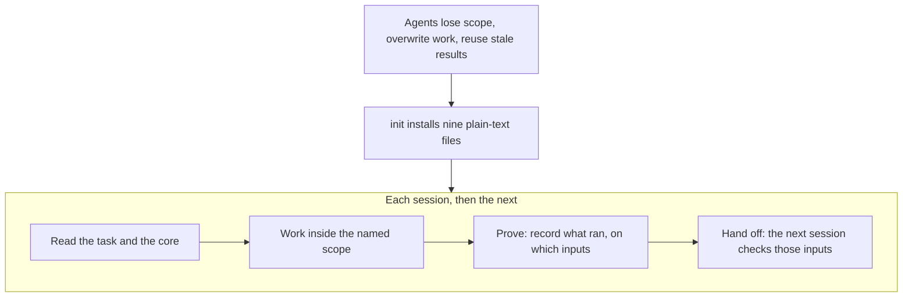
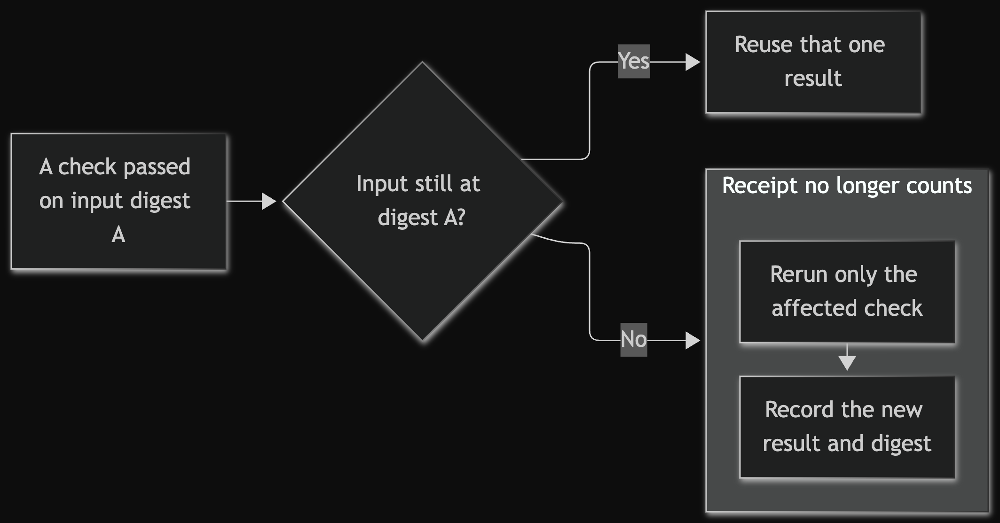
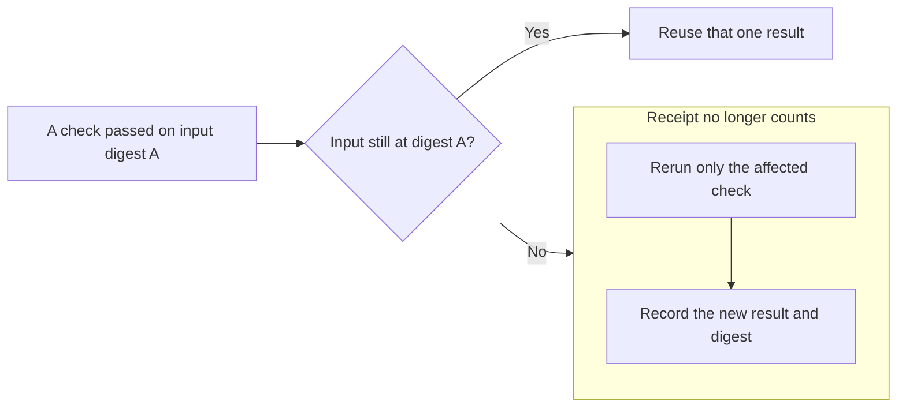
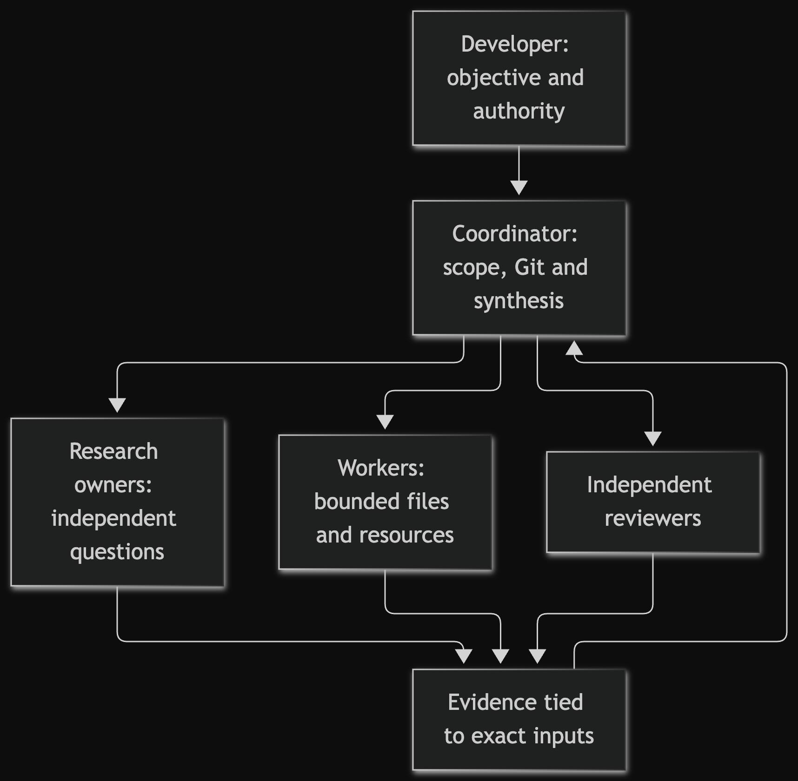
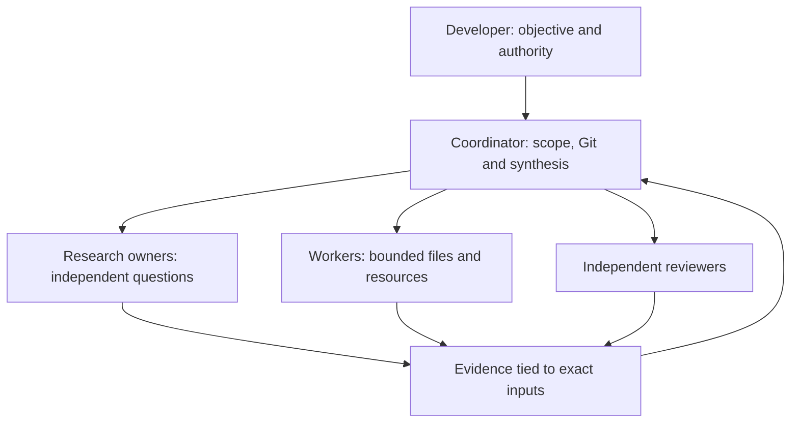
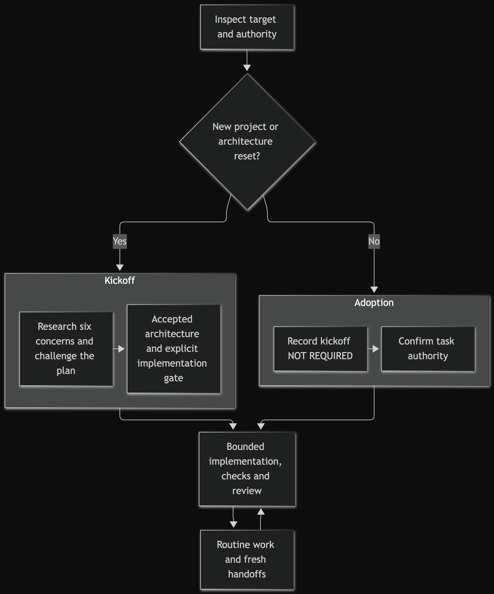
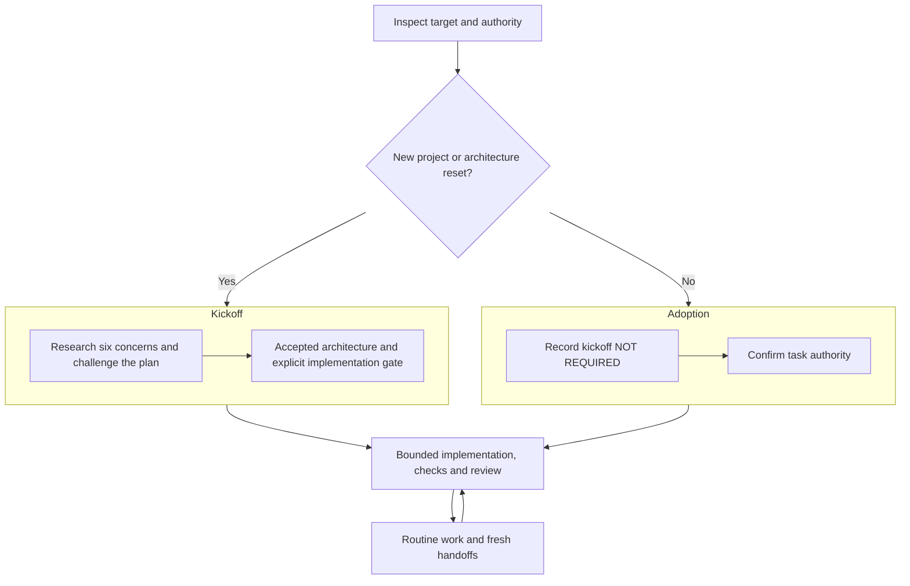
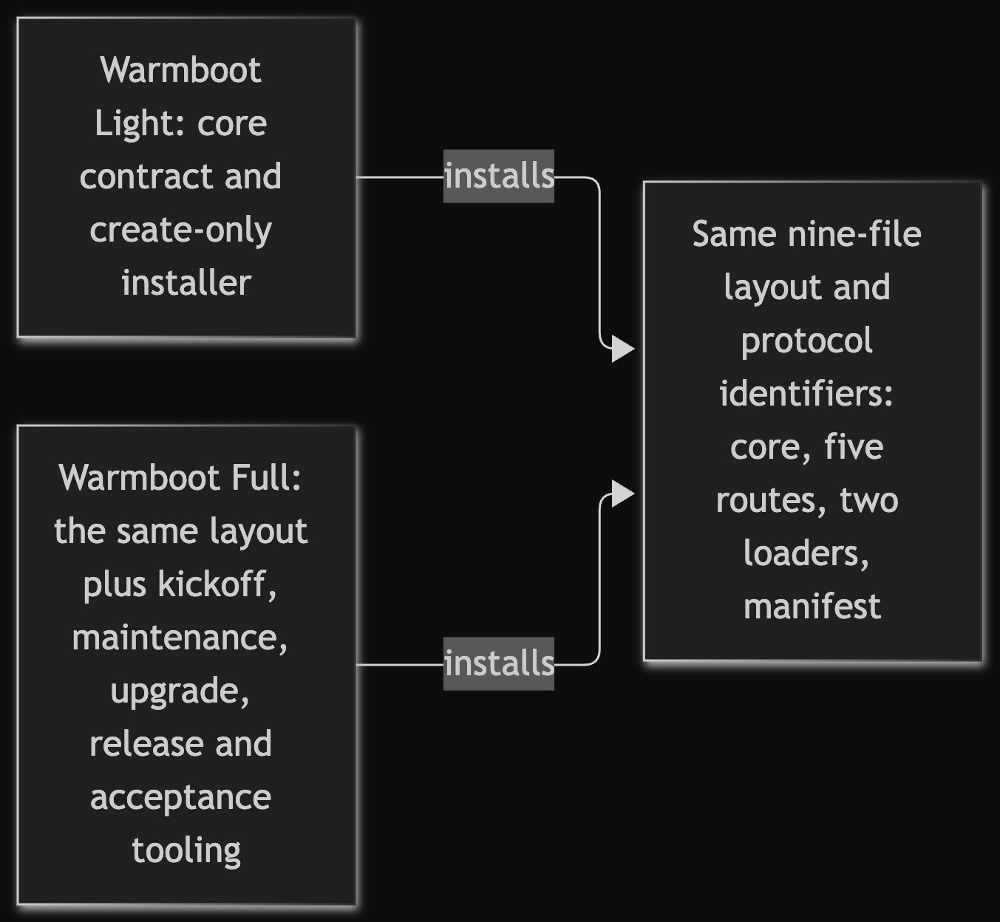
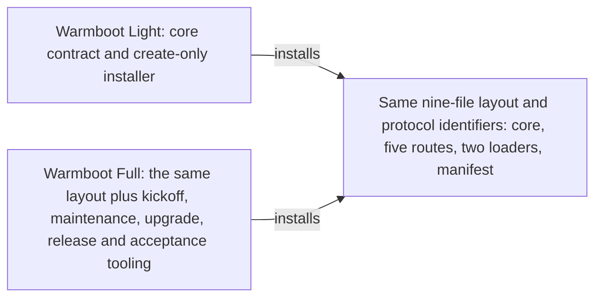

# Warmboot Full

Warmboot Full gives AI coding agents memory and rules across sessions. Without shared
state, a new session can start from zero: agents forget decisions, redo finished work,
trust stale results and lose each other's changes. Warmboot Full keeps a contract and the
task's state as plain text in the repository, read through AGENTS.md or CLAUDE.md. This
checkout also holds guidance for kickoff, maintenance, upgrades and releases, plus
structural acceptance checks and cold-start exercises for the protocol.

Designed and directed by Tiago Fonseca; implemented and reviewed with coding agents
under this protocol. This is the full edition of Warmboot;
[Which edition?](#which-edition) compares it with
[Warmboot Light](https://github.com/korreio/warmboot).

> **Status: experimental.** Warmboot is a collection of practices for running coding agents. It
> makes no promise of better results. Use it at your own risk and take what is useful.

<!-- mermaid-render:begin sha256=fdbbf7c1eddc58f24cbe778a40e194ceab7e64c7500dd6f621fae0d8d6eba70f -->


<details><summary>Mermaid source</summary>



</details>
<!-- mermaid-render:end -->

## Try it

From a clone of this repository (replace the demo path with your project's absolute
path to install for real):

```sh
mkdir -p .acceptance-work/readme-demo
readme_target="$(pwd)/.acceptance-work/readme-demo"
python3 -B bin/warmboot init "$readme_target"
python3 -B bin/warmboot init "$readme_target" --apply
python3 -B bin/warmboot check "$readme_target"
```

Read the preview before `--apply`; nothing is overwritten. For an existing
`AGENTS.md` or `CLAUDE.md`, see
[Existing agent instructions](BOOTSTRAP.md#existing-agent-instructions). It needs Python
3.11 or newer; apply needs macOS `renameatx_np` or Linux `renameat2`. No Windows parity
is claimed. Bootstrap completes when the architecture is accepted, the workspace exists
and independent review signs the completion receipt
([BOOTSTRAP §7](BOOTSTRAP.md#7-prove-review-and-hand-off)).

For a first integration, start the agent in this toolkit checkout or give it this
checkout's path: the installed core sends it to `WHY.md` and `BOOTSTRAP.md` here.

## What it installs

Two identical loaders (`AGENTS.md`, `CLAUDE.md`) open the core
`.agent-warmboot/core.md`, a copy of [WARMBOOT.md](WARMBOOT.md). The core holds the
invariants and points to five routes under `.agent-warmboot/routes/`: `context`,
`handoff`, `evidence`, `review` and `rotation`. `.agent-warmboot/manifest.json` records
one SHA-256 digest for each of the other eight files. Templates, examples, diagrams and
capability cards stay in this checkout.

## How a session uses it

For a new project, give an agent this prompt:

```text
Read AGENTS.md or CLAUDE.md. Take full ownership of bootstrapping a new project at <ABSOLUTE_TARGET_FOLDER> whose objective is <PLAIN_LANGUAGE_OBJECTIVE>. Do not publish anything remotely without my authorization.
```

The coordinator labels each result `PROVED`, `UNPROVED` or `BLOCKED` with the inputs it
ran on. Before reusing a result, a later session compares those inputs:

<!-- mermaid-render:begin sha256=f36013d0c1755f2e654697334a61769e141b047bc16aeb29e4e997a2eb3d517e -->


<details><summary>Mermaid source</summary>



</details>
<!-- mermaid-render:end -->

<!-- mermaid-render:begin sha256=00f96ebf81e8498fd40e00e05d450f4071c6d7d2af40c6741590a662fc88128a -->


<details><summary>Mermaid source</summary>



</details>
<!-- mermaid-render:end -->

The coordinator reconciles; no role grants publish authority.

## Updating an existing installation

[UPGRADING.md](UPGRADING.md) is the opt-in upgrade path once tagged releases exist.

## What it does not do

- No SDK, account, hosted service, package install or automatic upgrade.
- No enforcement: rules need a cooperating agent.
- No permanent process: [recurring tax](docs/recurring-tax.md) sets deletion conditions.

## Design decisions

| Term | Meaning here |
|---|---|
| Coordinator | The one agent or person who holds Git and remotes for a task. |
| Holder | The single named owner of a scarce or mutable resource, such as a test runner or device. |
| Route | A focused instruction file the core loads only when the task needs it. |
| Receipt | A task or handoff record of what was proved, on which inputs and snapshot. |
| `PROVED` / `UNPROVED` / `BLOCKED` | Evidence labels: shown by a run, not shown, or missing authority or access. |
| `CLEAN` / `FINDING` / `BLOCKED` | The only terminal verdicts an independent review may return. |

| Decision | Trade-off | Where to see it |
|---|---|---|
| One coordinator holds Git | Less parallelism; one owner for every Git change | [core](WARMBOOT.md) |
| Receipts bound to exact inputs | More bookkeeping; stale results are detectable | [evidence route](routes/evidence.md) |
| Create-only installer | Manual reconciliation; nothing overwritten | [bin/warmboot](bin/warmboot) |
| One-time kickoff with challenge | Front-loaded cost; settled architecture | [BOOTSTRAP.md](BOOTSTRAP.md) |
| Opt-in capability cards | Less built in; no process creep | [cards](templates/capabilities/README.md) |
| Core held to a word budget | Less detail; always loadable | [core](WARMBOOT.md) |

<!-- mermaid-render:begin sha256=bced5b6d012d129d21c2f4b6082cbcf5f1bfaffe7adcfcd9f8348f55779ac0f2 -->


<details><summary>Mermaid source</summary>



</details>
<!-- mermaid-render:end -->

### Guided tour

1. [WHY.md](WHY.md): the problem and what the kit refuses to be.
2. [WARMBOOT.md](WARMBOOT.md): start sequence, routes and invariants.
3. [evidence route](routes/evidence.md): how a claim earns `PROVED`.
4. [bin/warmboot](bin/warmboot): preview, create-only apply, manifest check.
5. [docs/acceptance.md](docs/acceptance.md): commands and their limits.

## Evaluate the claims

| Claim | Files | Command that checks it |
|---|---|---|
| Install is create-only | `bin/warmboot` | [Inventory](docs/acceptance.md#deterministic-command-inventory) helper suite |
| Payload carries the MIT notice | `LICENSE` | [Try it](#try-it), read `.agent-warmboot/core.md` |
| Tampering fails `check` | `bin/warmboot` | Edit `.agent-warmboot/`, rerun `check` |
| Receipts reject stale inputs | `routes/handoff.md` | Acceptance suite, `test_oracle.py` stale cases |
| Cards never install | `templates/capabilities/` | Focused capability command |
| Acceptance checkers claim only structure | `acceptance/*_oracle.py` | Fixture checkers |
| Loaders are identical | `AGENTS.md`, `CLAUDE.md` | Helper suite |

## Evidence and limits

Local checks and synthetic cases test specific contracts, and CI on Ubuntu and macOS
does not replace release proof; [acceptance](docs/acceptance.md) owns the limits.
Manifests do not authenticate provenance, provider neutrality is not runtime parity, and
the tree is unreleased.

No conclusive data on its benefit is available yet. Feedback and reports from use are welcome.

## Repository map

| Path | Purpose | Entry point |
|---|---|---|
| `bin/` | Installer | [`warmboot`](bin/warmboot) |
| `routes/` | Routes | [`context.md`](routes/context.md) |
| `templates/` | Samples | [`TASK.md`](templates/TASK.md), [`project-docs/`](templates/project-docs/README.md) |
| `templates/capabilities/` | Cards | [`README.md`](templates/capabilities/README.md) |
| `examples/` | Examples | [`README.md`](examples/README.md) |
| `acceptance/` | Checkers, prompts, fixtures | [guide](docs/acceptance.md) |
| `docs/` | Maintainer contracts and ADRs | [map](docs/maintainer-system-map.md) |
| `tests/` | Tests | [`test_warmboot.py`](tests/test_warmboot.py) |
| `tools/` | Renderer | [`render_mermaid_docs.py`](tools/render_mermaid_docs.py) |
| `mermaid/` | Rendered diagrams | [`README-1.png`](mermaid/README-1.png) |
| `.github/` | CI for Ubuntu and macOS, security policy, contribution guide and issue forms | [`tests.yml`](.github/workflows/tests.yml) |
| Consumer guides | Core, loaders, adoption | [WARMBOOT](WARMBOOT.md), [AGENTS](AGENTS.md), [CLAUDE](CLAUDE.md), [WHY](WHY.md), [BOOTSTRAP](BOOTSTRAP.md), [UPGRADING](UPGRADING.md) |
| Maintainer and history | Maintenance, roles, history | [MAINTAINING](MAINTAINING.md), [ROLE-INDEX](ROLE-INDEX.md), [CHANGELOG](CHANGELOG.md), [BUGFIXES](BUGFIXES.md), [SOURCE_REVISION](SOURCE_REVISION), [workspace](warmboot-full.code-workspace) |

## Which edition?

<!-- mermaid-render:begin sha256=41484d114c18c984bde72f4879338060f5f97bb8cee8a99a9e4010131af6dbbc -->


<details><summary>Mermaid source</summary>



</details>
<!-- mermaid-render:end -->

[Warmboot Light](https://github.com/korreio/warmboot) has its own repository;
each repository owns its own evidence.

## Validate this checkout

The [command inventory](docs/acceptance.md#deterministic-command-inventory) holds every
check, mirrored by CI. For maintenance, use a clean session:

```text
Read AGENTS.md or CLAUDE.md. Take full ownership of improving Warmboot Full at <ABSOLUTE_REPOSITORY> for <IMPROVEMENT_OBJECTIVE>. Treat <FROZEN_COMMIT_OR_TAG> as the immutable consumer baseline. Follow MAINTAINING.md, orchestrate only, do not edit other repositories, and do not publish remotely without my authorization.
```

## License

MIT, copyright 2026 Tiago Fonseca; see [LICENSE](LICENSE). The Unicode-derived range
tables keep their Unicode License V3 terms in [NOTICE](NOTICE);
[LICENSING](LICENSING.md) maps the scope.
