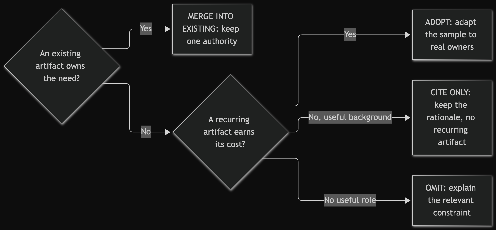
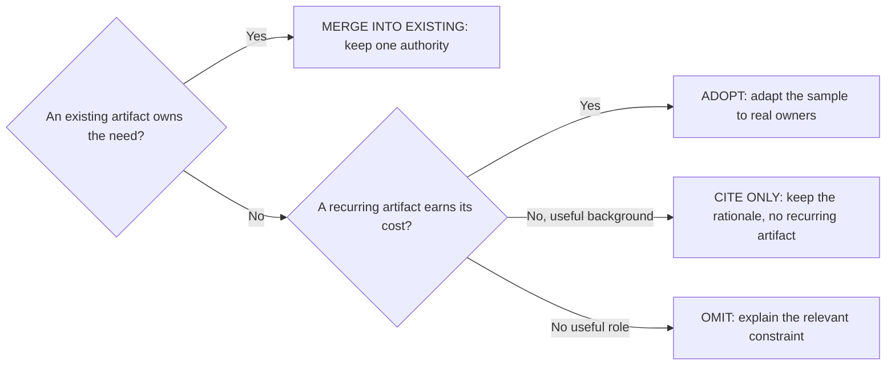

# Documentation architecture

This is the normative documentation contract for Warmboot Full and the single home for
the documentation-role model, the `ADOPT`/`MERGE INTO EXISTING`/`CITE ONLY`/`OMIT`
disposition vocabulary, and the manual role-selection surface a bootstrap coordinator
works from. The documentation package is part of the engineering architecture: it tells a
fresh agent where truth lives, who owns a boundary, what evidence is valid, and when a
temporary rule can be deleted. It is not prose to copy wholesale. `WHY.md` owns the
objective and `BOOTSTRAP.md` the takeover protocol and its staffing; neither is restated
here.

## The role model

A documentation role is a job, not a filename. Every adopted role carries three facts,
and a role that cannot supply all three is not adopted:

- **One owner** — a named person or surface answers for its content.
- **One update trigger** — a concrete change in the system makes it stale.
- **One retirement or deletion rule** — an observable condition ends it.

Classify roles, not filenames. Each role is selected by disposition and must earn its
recurring cost: reading, updating, reviewing, and the risk of stale truth. An empty
template, an unresolved `{{MARKER}}`, an invented command, a copied source-project
fact, or a heading kept without content is a bootstrap defect, not a documentation
package. The samples carry visible placeholders for exactly this reason.

## Disposition: `ADOPT`, `MERGE INTO EXISTING`, `CITE ONLY`, `OMIT`

This is the only normative definition of the four labels. Other surfaces cite it and may
state a scoped delta; none defines them again.

- **`ADOPT`** — the target lacks the role, the role changes a current engineering
  decision, an owner is named, every placeholder can be replaced from inspected source,
  and the recurring cost is justified.
- **`MERGE INTO EXISTING`** — the target already has a credible authority surface.
  Preserve its paths, stronger constraints, vocabulary, and history; transplant only the
  missing role fields; leave no competing template copy behind.
- **`CITE ONLY`** — provenance changes a target decision, but a recurring copy would
  duplicate or misrepresent the target's own evidence. Link the exact frozen source and
  state its limit.
- **`OMIT`** — the role would be empty, duplicative, speculative, unowned, too costly, or
  irrelevant to the project's hazards. Record the concrete mismatch and a revisit
  trigger.

Record every classification and destination in the current task or plan; for a merge,
record which existing file stays authoritative. Patterns already proved in the target's
own portfolio are presumed `ADOPT` or `MERGE INTO EXISTING`. A material `CITE ONLY`,
`OMIT`, or novel replacement bears the deviation burden carried by the
[disposition-record sample](../templates/project-docs/adoption-disposition.md): exact
source identity, concrete target mismatch, dated primary evidence, bounded comparison or
a stated unavailable-proof consequence, recurring tax, an independent challenger result,
and a reversal trigger. An incomplete material row keeps the dependent ADR unaccepted and
its gates `BLOCKED`.

## Role selection

Inspect the target first, classify each potentially useful role, then open only the
selected samples in `templates/project-docs/`. The helper never installs them.

| Need in the target | Sample | Common merge destination | Omit when |
|---|---|---|---|
| Provider-neutral safety core and task router | `AGENTS.md` | Existing root/provider instructions | Managed loaders suffice, or an existing router owns the role |
| Claude discovery pointer to the neutral contract | `CLAUDE.md` | Existing `CLAUDE.md` | Claude needs no discovery file, or an equivalent loader exists |
| Human/project entry point | `README.md` | Existing root README | Existing onboarding is current and complete |
| Documentation roles and lifecycle | `documentation-guide.md` | Existing contributor/docs guide | README/AGENTS already make every role unambiguous |
| One-time proven-pattern adoption and deviation evidence | `adoption-disposition.md` | Kickoff research brief or active plan | No material pattern or architecture/install choice is being classified |
| Local instructions for a genuinely different subtree | `subtree-instruction-overlay.md` | Closest existing local `AGENTS.md` or equivalent | Root routes and commands suffice for the whole tree |
| Boundary and ownership navigation | `system-map.md` | Architecture or ownership map | Source is tiny and navigation is obvious |
| Enforceable engineering rules | `engineering-standards.md` | Contributing/engineering guide | No rule survives beyond native source and tool configuration |
| Native commands and proof tiers | `testing.md` | Existing test guide or standards | Standards/README already route every meaningful check |
| Cross-owner state and behavioral invariants | `invariants.md` | State-machine or subsystem reference | The boundary is local and adequately owned by source and tests |
| User-visible release history | `CHANGELOG.md` | Existing changelog/releases | The target has no release-facing change history need |
| Reproduced-defect recurrence knowledge | `BUGFIXES.md` | Existing issue/post-mortem system | No reproduced defect warrants a durable entry |
| Small durable choices | `decisions.md` | Existing decision log | ADRs or code make the choice cheap to recover |
| Dated objective-specific stack/options evidence | `research-brief.md` | Existing research or spike brief | No new project/architecture decision is being made |
| Load-bearing cross-cutting decision | `adr.md` | Existing ADR directory | The decision is obvious, local, or cheaply reversible |
| Executable multi-step work | `plan.md` | Existing plan/task/issue | The current task artifact covers scope and sequencing |
| Independent review request/record | `review-brief.md` | Existing PR/review artifact | Review context is small and can live in the task |
| Repeatable operational or external procedure | `runbook.md` | Existing operations guide | README/testing own the commands, or no operational surface exists |

For a target with any human-authored code, the following roles are a floor, not optional
template inventory: human README/start route; conventional source/test/docs navigation;
source/engineering rules; testing/evidence owner; proportional component/ownership map;
change history; observed-defect/recurrence owner; current task/plan; and blocking
non-author review for every code change and other material work. These roles may merge
into fewer clear current surfaces. A separate file may be `OMIT`; the role may not,
unless inspection records `NOT APPLICABLE — NO HUMAN-AUTHORED CODE`.

A materially complex or multi-component coded project also owns a current quality-control
loop, merged into its plan/system map or a dedicated quality assessment. It assembles
evidence and explicit unknowns for applicable concerns, assigns owned next actions or
revisit triggers, and receives human or independent non-author challenge. Grades are
optional and cannot self-close; automation collects facts and regression flags only.

The overlay and runbook rows are the most conditional: shipping a sample is not evidence
that a target needs nested instructions or an operations manual. The decision log and ADR
are one role at two weights, not two homes for one decision; standards may absorb
testing, and a README may absorb a tiny system map or documentation guide. A study is a
native dated document with no generic sample — created once, frozen after, its living
conclusions moved to their owner.

Current-work aids live one directory above the pack and are equally subject to
disposition: [`templates/TASK.md`](../templates/TASK.md) only when no useful current
task, issue, or plan exists, and [`templates/HANDOFF.md`](../templates/HANDOFF.md) as the
routine by-reference state and freshness receipt for delegation, pause, resume, or a
session or provider change. It transfers no rules or authority; replacing an active
coordinator or singleton holder uses the rotation route.

One usable target-owned root `*.code-workspace` is a required bootstrap deliverable, not
an optional documentation role. This table never authorizes omitting it; only an
explicitly user-accepted documented replacement does, and `BOOTSTRAP.md` §5 owns that
contract.

## Authority precedence

Use the smallest applicable chain. A lower rank routes to a higher-detail owner; it never
duplicates that owner's content.

1. User objective and explicit authority — outcome, scope, external effects, and
   decisions reserved for the owner.
2. Current source, manifests, configuration, executable tests, and observed runtime
   state — what the project does now.
3. Root `AGENTS.md` plus the closest applicable subtree overlay — stable global
   safety and routing, and only genuinely local differences. Root wins globally; the
   closest declared overlay wins inside its subtree for an explicitly named item.
4. Routed living owners — system map, invariants/state, standards, testing, subsystem
   references.
5. Accepted ADRs and the active plan or task — decisions, sequencing, stops, open gates.
6. README, runbooks, changelog, and the observed-defect ledger — orient, operate,
   communicate, prevent reproduced recurrence.
7. Dated studies and review briefs — frozen evidence that never silently overrides a
   living owner.
8. Superseded or archived material — historical evidence only, pointing at its successor.

When surfaces disagree, current executable reality and the named living owner win unless
an explicit owner decision says otherwise. Correct the stale route or mirror in the same
change; never copy detailed truth upward into startup context. A handoff sits outside
this hierarchy: it links these sources and preserves freshness, changed-path, blocker,
and next-outcome facts, but never restates, replaces, grants, revokes, or transfers
rules, scope, permission, ownership, topology, review order, or external authority.

## Same-change update rules

Documentation is part of the change when its authority moves:

- user-visible behavior or required user action → changelog;
- reproduced defect fixed → observed-defect ledger;
- subsystem boundary, owner, or flow → system map;
- state, event, retry, reset, offline, or lifecycle semantics → invariants/state owner;
- native command, test tier, or evidence meaning → testing guide and every routed row
  that names it;
- engineering rule, dependency policy, closing gate, or documentation trigger →
  standards;
- every new or materially changed human-authored code file → immediate
  language/community-native orientation; consequential local rationale/assumption →
  adjacent source/API documentation;
  cross-cutting rationale/invariant → its system map, invariant owner or ADR;
- diagrammed relationship/state/data flow → editable source, useful text alternative,
  diagram owner and update trigger in the same change;
- proven-pattern classification or deviation evidence → the disposition record and the
  ADR or plan gate that depends on it;
- durable cross-cutting choice or load-bearing assumption → ADR or the existing decision
  log; a new project technology or architecture also needs a dated research brief and an
  install plan;
- plan scope, task state, owner stop, acceptance, or cleanup condition → active
  plan/task;
- setup, public topology, or onboarding path → README;
- documentation role, location, naming, precedence, or retirement policy → this file and
  any stale mirror;
- subtree-local owner, route, command, hazard, or override → closest local overlay;
  repeatable operational ordering, prerequisite, authority, abort, rollback, or sign-off
  → runbook.

These owners move inside the change, not in a review afterwards. Update only real
fallout, and prefer extending an existing authority over creating a new file.
Documentation edits carry the same authority rules as code: the coordinator is the sole
Git mutator, and a bounded documentation lane's initial assignment may include only the
read-only history allowlist in `routes/context.md`, from which every `git diff`
form is excluded.

## Provider entry surfaces

`AGENTS.md` is the canonical provider-neutral project contract. `CLAUDE.md` exists so a
Claude harness can find that same authority; it is a thin pointer or an equivalent loader
to one neutral core, and must not grow a second policy set. Read root first, then the
closest applicable overlay. An overlay may add genuinely local routes, commands,
ownership, or hazards, or explicitly override one named root item inside its subtree; it
must not duplicate global Git, external-effect, review, or handoff rules, and it is
removed when the local distinction disappears. Provider discovery mechanics never create
a second policy authority. A symlink can enforce one source where the platform preserves
it; the templates use a real pointer file because it carries cleanly into Windows and VS
Code workspaces.

Two adoption shapes are supported:

- **Managed bundle.** The helper installs small `AGENTS.md` and `CLAUDE.md` loaders
  pointing at `.agent-warmboot/core.md`, then checks manifest-declared structure and
  content. The manifest and its `source_revision` are self-declared local metadata — a
  coherent rewrite is not detectable as an authenticity failure — so provenance requires
  a separately recorded external commit, tag, or digest. Project facts stay in the
  project's own routed docs. Do not swap a managed loader for the optional project
  `AGENTS.md` sample and still claim an exact manifest match.
- **Native-merged adoption.** A bootstrap agent reconciles the kernel and the
  `templates/project-docs/AGENTS.md` task router into an existing project instruction
  surface, preserving stronger target rules. `CLAUDE.md` remains a thin pointer or
  equivalent loader. Exact-content `bin/warmboot check` may be inapplicable; native
  inspection and project checks become the evidence.

## Templates versus adopted copies

Templates are seeds, not a synchronized upstream. An adopted copy is expected to diverge
as the target populates it with real owners, paths, commands, and history; that
divergence is the intended outcome, not drift. The adopted file is the owner from the
moment it lands: the template is never retro-synced from it, and a later template change
never authorizes overwriting an adopted copy — it becomes ordinary upgrade material with
its own disposition. Warmboot Full's own role-by-role self-adoption, including the roles
it deliberately omits, is recorded in [`adoption-disposition.md`](adoption-disposition.md).

Examples demonstrate behavior and acceptance; they are not hidden defaults. Navigate
populated examples by role. [Source admission](source-refresh.md), the
[capability rationale](capability-design.md) and [sample manifest](../examples/MANIFEST.json)
record current local lessons and rights. Toolkit evidence never becomes target evidence.

## Lifecycle and deletion

Every adopted recurring artifact needs a current owner and decision value.

- **Living owner:** update in place. No `-v2`, `-final`, or parallel truth files.
- **Frozen evidence:** date it and do not rewrite its historical claims.
- **Superseded:** name the successor and stop citing the old surface as current.
- **Temporary artifact:** record owner, reason, recurring cost, and an observable
  deletion condition when it is created; delete it when the condition is met.
- **Regression pin:** admit only after an observed defect that a behavior check cannot
  guard. Record source owner, recurrence class, why behavior is insufficient, cost, and
  deletion condition.
- **Plan cleanup:** deletion that depends on cutover, migration, production, owner
  approval, or external confirmation is a separate task after that evidence exists.
  Never infer authorization from implementation completion.
- **Archive:** only when historical evidence stays useful; a small project may simply
  delete superseded low-value material.

No generated index, mandatory frontmatter, link database, documentation dashboard, review
registry, or automated catalogue is part of this package. A target may retain native
machinery that already earns its cost, but Warmboot does not introduce it by default.

## From a document role to a maintained artifact

<!-- mermaid-render:begin sha256=b73c4af7bf3f180e2253b1533520194c211dbb6ca85043af3aae1aca9d464193 -->

Mermaid source

<!-- mermaid-render:end -->

The disposition records a decision, not permission. Adopted or merged artifacts need a
current owner, a concrete update trigger and a retirement condition; a linked example or empty
template cannot supply target evidence. Owner: documentation architecture maintainer.
Update this diagram when role selection or lifecycle semantics change.
