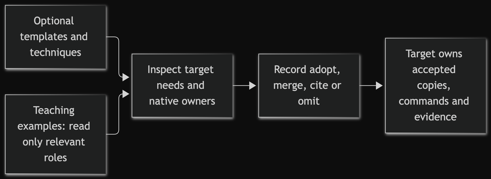
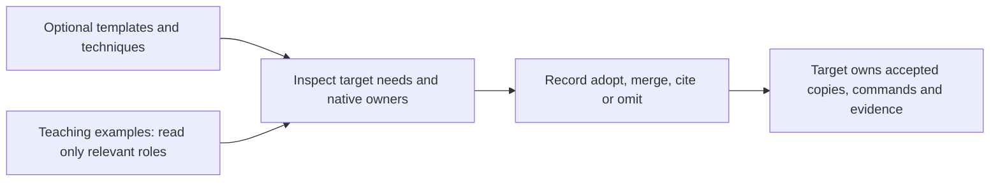

# Examples

These examples show optional techniques. They grant no install, live-operation or
publication authority and do not mandate a language, framework or agent platform.

| Example | Purpose | Evidence boundary |
|---|---|---|
| [Documentation package](documentation-package/README.md) | Populated Python project with plans, decisions, review and stale-receipt relationships | Synthetic teaching records, not proof of a live agent team or current check results |
| [Small Python target](python-clean/README.md) | Minimal native source/test layout | Local behavior only |
| [Agent instructions](agent-instructions/README.md) | One shared neutral policy with a thin discovery loader | A reusable instruction example, not platform-parity proof |

[MANIFEST.json](MANIFEST.json) records only the neutral agent-instruction sample.
It is not an exhaustive inventory of the teaching package or all files beneath
`examples/`. The repository licence map covers all examples.

<!-- mermaid-render:begin sha256=d3132f2dd443b86ad3a04eb3174921c6fca8a3b7e1646d7a753dfe08db3a29af -->

Mermaid source

<!-- mermaid-render:end -->

Examples inform a decision; their fictional outputs never become target proof.
Owner: example maintainer. Update this index when an example's purpose or prerequisites
change; retire one when it no longer teaches a useful behavior.
